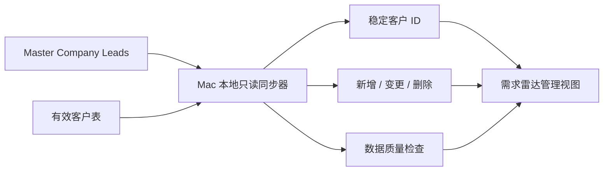

# 需求雷达 V2：真实客户数据同步（脱敏展示）

本展示说明演示 Iteration 6 如何把两张销售业务表自动转换为需求雷达的数据健康视图。

## 工作流程

## 设计原则

- 销售只维护原有两张业务表，不新增第三张表。
- Excel 解析、文件哈希、去重和质量检查由 Mac 本地完成。
- 文件没有变化时复用上次快照，避免重复全表处理。
- GitHub 展示仓库只保存虚构示例数据，不包含客户名单、联系方式、服务器地址、密钥或内部运行结果。
- 真实结果仅保存在授权 Mac 和隔离的生产节点。

## 可展示字段

- 同步时间与运行方式
- 合并客户总数
- 本次新增、变更、删除数量
- 有效与待确认客户数量
- 数据完整度及待补充数量

本文件对应生产实现版本 `aa7337542506b8c5f7e6a87c4c166054199fa27b`，但不复制任何生产数据或内部配置。
